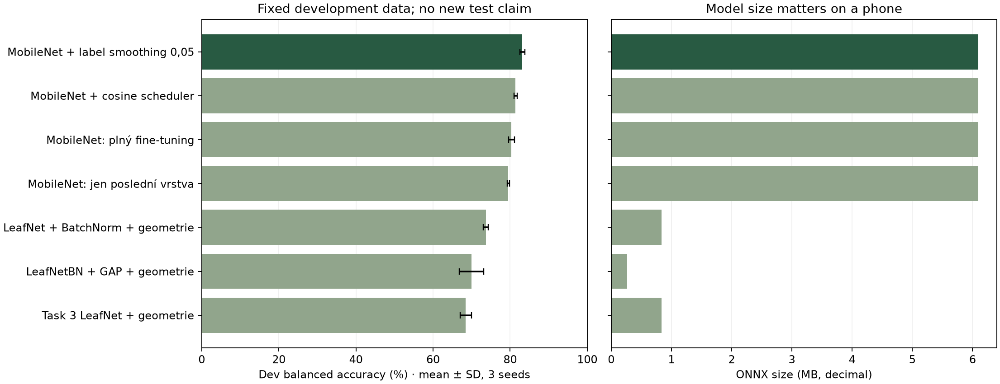

# Nové srovnání sítí a trénovacích variant

Technická měření agenta, 11. 11. 2026. **21 nových běhů, 7 variant, 3 seedy. Nejde o nový nezávislý test ani o měření telefonu.** Původních 12 běhů zůstává v [archivním reportu](TRAINING_RESULTS.md).

## Protokol a férovost

Všechny nové varianty dostaly stejných 649 trénovacích fotografií, 15 epoch, batch 32, Adam s LR 0,001 a stejnou geometrickou augmentaci: crop 0,7–1,0, horizontální/vertikální flip a rotaci ±20°. ColorJitter je v této nové studii vypnutý, aby neměnil další faktor. Každá varianta začíná znovu pro seedy 0, 1, 2. Udržuje se nejlepší dev checkpoint.

Dev skóre je rovnoměrný průměr čtyř balanced accuracies: původní validace 29 snímků, historický dev 137 snímků a předem vytvořená camera-like kopie každé. Tyto pohledy nejsou nezávislé. Fotografický obsah je napříč variantami stejný; inicializace a transformace jsou řízené seedem. [Protokol a hash dat](training/runs/networks_v1/protocol.json) a [detailní metriky](training/runs/networks_v1/results/evaluation.json) jsou uložené.

Historická sada 120 snímků je již známá z první studie. Nový evaluator běžel s `--dev-only`: nová měření vůbec neobsahují `test` ani `camera_test`. **Pro závěrečné ověření nového modelu je nutná nová telefonní/session sada.**

## Výsledky a cena modelu

| Varianta | Dev skóre % (průměr ± SD) | Parametrů celkem | Trénovatelných | ONNX MB | WASM medián ms |
| --- | ---: | ---: | ---: | ---: | ---: |
| LeafNet + BatchNorm + geometrie | 73,68 ± 0,66 | 208 644 | 208 644 | 0,836 | 2,0 |
| LeafNetBN + GAP + geometrie | 69,99 ± 3,16 | 65 284 | 65 284 | 0,262 | 2,0 |
| Task 3 LeafNet + geometrie | 68,46 ± 1,48 | 208 292 | 208 292 | 0,836 | 2,0 |
| MobileNet + cosine scheduler | 81,36 ± 0,41 | 1 521 956 | 1 521 956 | 6,098 | 3,0 |
| MobileNet: jen poslední vrstva | 79,48 ± 0,29 | 1 521 956 | 4 100 | 6,098 | 3,0 |
| MobileNet: plný fine-tuning | 80,35 ± 0,80 | 1 521 956 | 1 521 956 | 6,098 | 3,0 |
| MobileNet + label smoothing 0,05 | 83,14 ± 0,66 | 1 521 956 | 1 521 956 | 6,098 | 3,0 |



WASM časy jsou z desktopového Macu ve WebKitu, jeden thread, 5 warm-upů a 20 měření, nikoli z iPhonu. WebKit má hrubší rozlišení hodin; hodnoty kolem 2–3 ms se nesmí interpretovat jako přesný telefonní benchmark. [Chrome i WebKit profily](training/runs/networks_v1/results/browser_profiles.json) navíc ověřují shodu každého modelu s PyTorch do 1e-5 na referenčním vstupu. Zmrazený MobileNet má stejný objem a inferenční práci jako plně trénovaný; šetří trénink, ne stažení modelu.

## Co přinesla která změna

- **BatchNorm** proti stejnému vlastnímu LeafNetu zvedl průměrný dev výsledek přibližně o 5,21 procentního bodu. Toto porovnání mění jen BN a vychází ze stejných Task 3 konvolučních bloků.
- **GAP** snížil počet parametrů z 208 644 na 65 284 a ONNX z přibližně 0,836 na 0,262 MB, ale zhoršil dev skóre oproti LeafNetBN asi o 3,69 bodu. V tomto rozpočtu není nejpřesnější. Většina konvoluční práce zůstala, takže zmenšení souboru neznamená stejně velké zrychlení inference.
- **Předtrénovaný MobileNet** překonal vlastní sítě trénované od nuly. Není to čistý test samotné architektury: současně využívá znalosti z ImageNetu. Praktický závěr platí pro tyto dvě celé trénovací strategie, ne pro tvrzení, že vlastní konvoluční síť nikdy nemůže vyhrát.
- **Zmrazení** trénuje jen 4 100 parametrů poslední vrstvy; všechny ostatní váhy, BN statistiky i dropout zůstávají v eval režimu. Proti plnému fine-tuningu je průměr asi o 0,87 bodu nižší. To může být užitečný kompromis při omezeném tréninkovém výkonu.
- **Cosine scheduler** proti konstantnímu LR přidal asi 1,00 bodu. Je to menší efekt než zisk z dat v první studii. TMax=15 a počet epoch zůstávají stejné; neměnili jsme současně délku tréninku.
- **Label smoothing 0,05** proti základnímu fine-tuningu přidal asi 2,79 bodu, při stejné architektuře a velikosti souboru. Rozdíl převyšuje zaznamenané SD mezi těmito třemi seedy, ale to samo není test statistické významnosti ani důkaz lepší kalibrace pravděpodobností. Trénovací loss se smoothingem není přímo srovnatelná s nesmoothovanou loss; eval loss zůstala stejná.

## Volba pro web

Podle průměru dev skóre byla vybrána **mobile_smoothing** a podle předem určeného mediánu seed **0**, nejlepší epocha **14**. Jeho konkrétní dev skóre je **82.76%**; průměr celé varianty je **83,14 %**. Dosud nasazený model měl na stejné dev definici **79.98%**. Nenahrazujeme tato čísla historickou testovou accuracy 79,17 % z jiného checkpointu.

MobileNet ponechává rozumný přibližně 6,1MB soubor a ve zdejším desktopovém WASM benchmarku nevytváří zásadní latenci. Vlastní BN/GAP síť by byla vhodný kandidát, kdyby prioritou byla velikost a nové telefonní měření ukázalo přijatelnou přesnost. Před další změnou volby je potřeba skutečný telefonní test, ne vybírání podle již známého historického testu.

## Notebook a JPEG

Uživatelem schválená oprava Task 3d používá `aug_train_loader`, oba train loadery mají vlastní pevný generátor a vlastní Dataset filtruje obrázkové přípony. Modely z Task 3 jsou v [networks.py](training/networks.py) přímo a čitelně zkopírované; [behaviorální kontrola](training/runs/networks_v1/results/network_checks.json) porovnává jejich výstupy se skutečnými třídami z notebooku. Původní notebook je lokálně zálohován. Opravený notebook prošel 30/30 buňkami a 15/15 věcnými kontrolami; Task 2 export je oddělen do `exports/task2/`.

JPEG fotografie dekóduje jednotný lokální WASM [jSquash/MozJPEG](https://github.com/jamsinclair/jSquash/tree/main/packages/jpeg) verze 1.6.0. Původní JPEG a referenční pixely se nemění; nepoužíváme browser-specifické očekávané hodnoty. Reference prošla přísnou tolerancí 1e-5 a shodou na tři desetinná místa ve WebKitu i Chrome. Všech osm EXIF orientací navíc dává přesné stejné pixely jako Pillow + exif_transpose. Kamera tuto JPEG větev nepotřebuje. Knihovna i její WASM se načítají z CDN; samotné fotografie se nikam neposílají.

Ověřen je i 12MP JPEG upload. Náhled je omezen na 1024 × 1024 pro úsporu paměti; inference dál používá původní obraz a centrální 96px výřez. U větších fotografií stále probíhá převzorkování přes Canvas: jeho high-quality filtr se může mezi prohlížeči lišit. Shoda dekódovaných JPEG pixelů proto není tvrzením, že libovolná zmenšená fotografie musí mít identické skóre napříč prohlížeči. Přísná reference 96 × 96 tento další resize nepotřebuje. Sjednocení resamplingu je případný další samostatně měřený krok, ne skrytá změna nynějších experimentů.

## Reprodukce

```sh
python training/train.py --run-dir training/runs/networks_v1 --variants mobile_geo mobile_frozen mobile_cosine mobile_smoothing leaf_geo leaf_bn_geo leaf_gap_geo --seeds 0 1 2 --epochs 15
python training/evaluate.py --run-dir training/runs/networks_v1 --baseline training/runs/networks_v1/checkpoints/baseline_before_networks.onnx --baseline-sha256 22bde880732116f01725c7b7d9bd58f14d7a5be62be593d3ad71657ebd9ad64a --dev-only
python training/export_model.py --run-dir training/runs/networks_v1 --output-dir exports/candidate
```

Pro čerstvou reprodukci použij nový run-dir. Původní baseline této studie lze obnovit z commitu `0303611e72702491b5e38114620f30c72a9ea7c5`. Checkpointy nejsou publikované; samotné veřejné JSONy trénink nenahrazují. MPS nemusí být bitově reprodukovatelné na jiném hardware. Automatické technické podklady: [návrh reportu](REPORT_DRAFT.md), [návrh review](REVIEW_DRAFT.md), [aktuální model](release_info.json).


## Zlepšení použitelnosti: výsledek přímo u hledáčku

Uživatel při skutečném používání na **iPhonu 13 mini** upozornil, že pro přečtení vítězné třídy musel odscrollovat od kamery, a tím ztrácel přehled o záběru. Hlavní výsledek jsme proto přesunuli přímo pod hledáček: jméno nejvýše skórující třídy, procentní skóre a označení nejistoty se aktualizují společně s původními čtyřmi pravděpodobnostmi.

Mobilní režim po spuštění kamery nebo výběru fotografie skryje velký úvod a přesune pohled na vstupní panel. Čtvercový hledáček se vejde do dostupné výšky pomocí svh a safe-area insets, ovládání zachovává dotykové cíle a při otočení telefonu se rozložení přizpůsobí. Podrobné pravděpodobnosti a diagnostika zůstaly níže.

WebKit a Chrome prošly kontrolou rozměrů 375 × 812, 375 × 650, 375 × 600 a landscape 812 × 375; test ověřuje současnou viditelnost hledáčku, vítězné třídy a ovládání, přepínání vítěze i skutečně běžící simulovaný stream v Chrome. [Záznam](training/results/mobile_layout_checks.json). To není fyzické potvrzení opravy na telefonu: **DOPLNIT vlastní ověření nového rozložení a screenshot na iPhonu 13 mini**.

Jde o zlepšení použitelnosti, nikoli přesnosti. Síť, váhy, preprocessing a vypočtená skóre se touto úpravou nemění.
