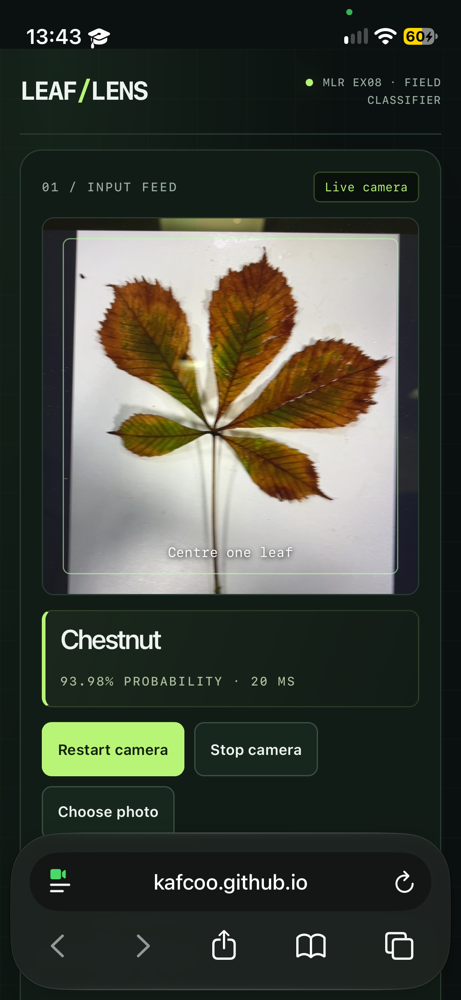

# App review

## 1. Phone camera

I tested [my app](https://kafcoo.github.io/mlr-ex08/) in Safari on an iPhone 13 mini running iOS 27.2. I allowed camera access and tried the controls, including stopping and restarting the rear camera. They worked.

I pointed the camera at 15 leaf photos on my laptop screen, using pictures the model had not seen. The top class was correct for 14/15 photos; one chestnut was classified as apple. This was a small trial with photos on a screen, not physical leaves. The first load was slow, but recognition felt immediate afterwards. When I opened the app again, it worked well. I preferred having the result directly below the camera, so I used the updated mobile layout.

Other examples: [Apple](screenshots/B362332A-9A01-42FF-8306-D387289A19FA.png), [Maple](screenshots/1549F12A-1D88-4AFC-8917-DB87F52D609A.png).

I also tried photo uploads on my laptop: [Apple](screenshots/laptop-apple.png), [Maple](screenshots/laptop-maple.png) and [Cherry](screenshots/laptop-cherry.png), each showing all four probabilities. These are separate from the phone trial. The diagnostics below them show the earlier reference check, not the currently displayed leaf.

## 2. Reference probabilities

I ran the reference check for `check_image.jpg` on my phone:

| Class | Phone | Notebook (`check_expected.json`) |
| --- | ---: | ---: |
| apple | 0.52518128 | 0.52518541 |
| cherry | 0.45120817 | 0.45120409 |
| chestnut | 0.01689341 | 0.01689340 |
| maple | 0.00671714 | 0.00671715 |

All four agree to three decimals. The maximum absolute error was 4.122e-6, below 1e-5, and both checks showed PASS. A shared local JPEG decoder fixed the earlier browser decoding differences.

I also loaded my `leaf_model.onnx` in the course classifier and tested the reference photo. It worked and predicted apple, but its probabilities differed slightly (apple 0.530072), so I do not count that as three-decimal agreement.

## 3. Preprocessing

My app's `preprocess()` in `index.html` takes a central square crop, resizes it to 96 × 96 and normalizes each channel as `(RGB / 255 - mean) / std`. The values match `model_info.json`: mean `[0.485, 0.456, 0.406]` and std `[0.229, 0.224, 0.225]`. This puts the input on the scale expected by the model. The tensor contains R, G and B planes in shape `[1,3,96,96]`. Output classes are ordered apple, cherry, chestnut, maple.

## 4. Local processing

My app processes camera frames and selected photos locally with ONNX Runtime Web. It loads the model, metadata and reference files from my GitHub Pages site. `cdn.jsdelivr.net` supplies ONNX Runtime, the QR library and the JPEG decoder, including their WASM files. These requests download code and assets; they do not upload the images. Selected files use local blob URLs, and the QR code is generated in the browser.

The code review and automated network check found no image uploads. I did not separately capture network traffic on my phone.
