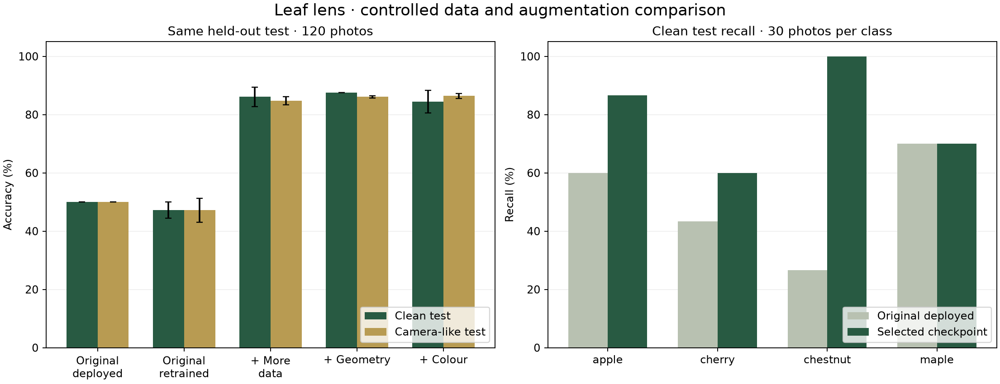

# Leaf lens: measured training comparison

> **Archived first study.** This describes the original 12-run experiment and its previous checkpoint/JPEG behavior. The current model and resolved JPEG handling are documented in [NETWORK_RESULTS.md](NETWORK_RESULTS.md) and [release_info.json](release_info.json). Historical test scores below must not be attributed to the new release.

Generated technical measurements, 11 November 2026. This records what ran and what was measured; it is not a claim of physical iPhone-camera accuracy.

## Result

The checkpoint selected **using development data before any final test inference** is `expanded_color`, seed **2**. The representative seed is the middle run by development score; the variant is selected by its mean development score over three seeds.

On the same held-out historical test, the original deployed model scored **50.00%** and the selected checkpoint scored **79.17%**. On fixed camera-like versions of those same photos, they scored **50.00%** and **85.83%**. The two test views are correlated, not 240 independent photographs.

## Controlled comparison

All new runs use ImageNet-pretrained MobileNetV3-small, 96 × 96 input, identical normalization, batch size 32, Adam at 0.001 and 15 epochs. The entire network is fine-tuned. Each run keeps its best development checkpoint, which differs from the original notebook's final-epoch export. Changes are cumulative: more data, then geometric augmentation, then colour jitter. Each new variant uses seeds 0, 1 and 2.

| Model / cumulative change | Runs | Dev score (%) | Clean test accuracy (%) | Camera-like test accuracy (%) |
| --- | ---: | ---: | ---: | ---: |
| Original deployed model | 1 | 57.35 | 50.00 ± 0.00 | 50.00 ± 0.00 |
| Retrained · original data | 3 | 57.01 | 47.22 ± 2.83 | 47.22 ± 4.10 |
| + Historical data | 3 | 78.30 | 86.11 ± 3.36 | 84.72 ± 1.42 |
| + Geometry | 3 | 80.35 | 87.50 ± 0.00 | 86.11 ± 0.39 |
| + Colour | 3 | 80.58 | 84.44 ± 3.87 | 86.39 ± 0.79 |

The dominant gain is from adding historical training data. Geometric augmentation gives a smaller mean clean-test improvement; colour jitter does **not** improve mean clean-test accuracy over geometry in these runs. Colour's mean development advantage over geometry is only 0.23 percentage points, smaller than its between-seed spread. These experiments do not establish that colour jitter is the better recipe. The deployed checkpoint follows the development-only selection rule fixed before test evaluation; it was not switched to the best-looking test run afterwards. Further recipe changes need a new independent test set.

`±` is the population standard deviation **across seeds**, not a confidence interval over photos. The original deployed model is a single fixed checkpoint; its displayed zero spread is not an uncertainty estimate. Clean test has 30 images per class, so ordinary and balanced accuracy coincide there. One error changes overall accuracy by 0.83 percentage points. Small seed differences do not establish statistical significance or field generalization.

Development score gives equal weight to balanced accuracy on original validation, historical development, and a fixed camera-like view of each. No test result was used for checkpoint, variant or seed selection. See [selection.json](training/results/selection.json) and [all per-run metrics](training/results/evaluation.json).

## Data cleaning and split

- Inputs: **956** photos (136 original, 820 historical).
- Removed **21** files: **17** redundant decoded-pixel duplicates and **4** photos in conflicting-label groups. Conflicting classes were apple/cherry; both copies were excluded instead of guessing the label.
- For duplicates crossing train/validation, the validation copy was preserved and the training copy was removed.
- Original-only training: **107** photos. Expanded training: **649** photos (166 apple, 166 cherry, 155 chestnut, 162 maple).
- Development: **29** original validation photos plus **137** reserved historical training photos (stratified split seed 2026). All variants use these same development sets.
- Final test: **120** historical validation photos. No exact decoded-pixel overlap with any development/training set.
- Camera-like transforms were generated once with seed 314159: crop scale 0.7–1.0, rotation ±20°, brightness/contrast ±0.25, saturation ±0.2 and hue ±0.03. Geometry training also includes horizontal and vertical flips.

The [full audit](training/results/data_audit.json) lists every retained image, destination and exclusion. Raw data and checkpoints remain local. Exact duplicates were removed; unrecognized near-duplicates or photos of the same physical leaf may remain because plant/session identifiers are unavailable.

## Selected model: clean-test confusion matrix

Rows are true classes; columns are predictions.

| True / predicted | apple | cherry | chestnut | maple |
| --- | ---: | ---: | ---: | ---: |
| apple | 26 | 3 | 1 | 0 |
| cherry | 12 | 18 | 0 | 0 |
| chestnut | 0 | 0 | 30 | 0 |
| maple | 1 | 4 | 4 | 21 |

## Export and web checks

- ONNX opset **17**, input **1 × 3 × 96 × 96**, four output logits, **6,097,584 bytes**.
- Class names and preprocessing are also embedded in ONNX under `model_info`, as required by Task 2e and the course camera app.
- Model SHA-256: `22bde880732116f01725c7b7d9bd58f14d7a5be62be593d3ad71657ebd9ad64a`.
- Maximum PyTorch/ONNX logit difference on five fixed random inputs: **1.98e-05**. The reference-image probabilities were checked separately.
- The reference JPEG is unchanged; [check_expected.json](check_expected.json) now corresponds to the newly trained model. Previous values remain in Git history.

| Reference class | PyTorch expected probability |
| --- | ---: |
| apple | 0.8102642298 |
| cherry | 0.1260144562 |
| chestnut | 0.0231471751 |
| maple | 0.0405741669 |

Browser verification results are documented in [the README](README.md) and [browser measurements](training/results/browser_validation.json). Native JPEG decoding differs between WebKit and Pillow/Chrome: WebKit's maximum probability discrepancy is about 0.00118 (0.118 percentage points). With the [lossless fixture containing the exact Pillow RGB pixels](training/results/reference_pixels.png), both browsers match PyTorch within 0.00000025. The JPEG-aware reference check therefore uses absolute tolerance 0.002; the separate same-pixels model check uses 0.00001. This distinguishes decoder variation from an export/preprocessing failure.

Passing the JPEG-aware tolerance does **not** mean agreeing to three decimals. WebKit currently rounds apple to 0.811 while PyTorch rounds it to 0.810. The site reports these two checks separately. See [the requirement audit and remaining student tasks](AUDIT.md); native-JPEG three-decimal agreement remains an open requirement on WebKit.

The browser's low-confidence display uses a fixed heuristic: top probability below 0.65 or top-two margin below 0.15. It preserves all four class probabilities. It is not a learned unknown class, and high confidence does not prove that a leaf belongs to a known species. A fifth-class detector needs representative negative training and evaluation data.

## Reproduce and interpret

See [training instructions](training/README.md), [pinned dependencies](training/requirements.txt), [data preparation](training/prepare_data.py), [training loop](training/train.py), [evaluation](training/evaluate.py), and [ONNX export](training/export_model.py). Fixed seeds do not guarantee bitwise-identical MPS results on different hardware/software. The original deployed model is recoverable from the initial Git commits; its recorded SHA-256 is `ae31c68aa9920808565fed2eaf50164647f90887b396a9fafe02fb9e4f034f7f`.

Synthetic camera-like accuracy estimates robustness to those particular transforms. New real phone photographs, ideally grouped by plant and capture session, are needed for an independent field test. No physical iPhone camera was available during this run. Do not interpret the 29-photo original development score as an independent test.
